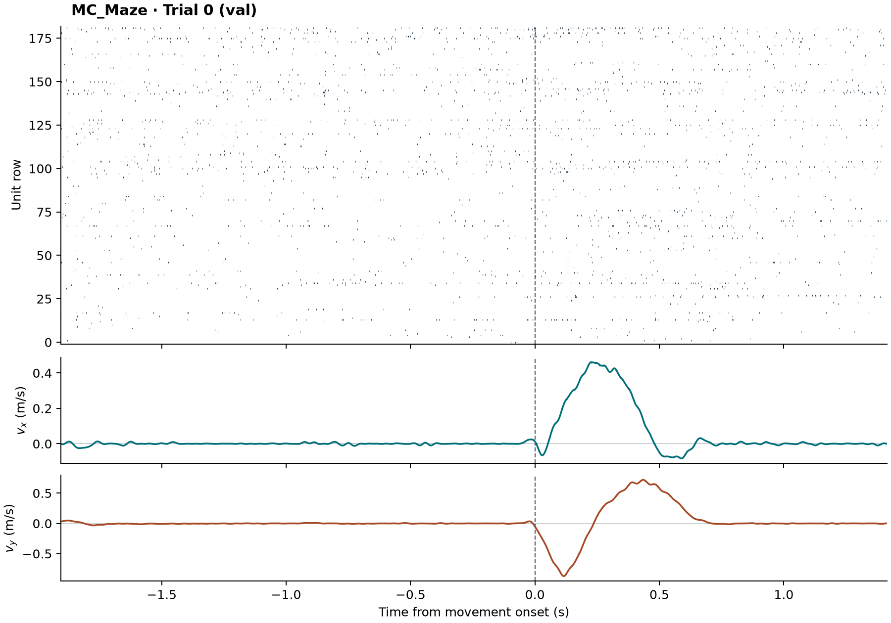

# MC_Maze spike raster and hand velocity

This is the data-loading milestone for a 2D hand-velocity decoding project.
It plots sorted spikes from macaque primary motor and dorsal premotor cortex
alongside the hand velocity supplied by MC_Maze. The dataset authors calculated
velocity offline from recorded hand position.
[DANDI 000128, version 0.220113.0400](https://doi.org/10.48324/dandi.000128/0.220113.0400) ·
[Neural Latents Benchmark dataset notes](https://neurallatents.github.io/datasets#mc_maze)

## Reproduce the figure

From the project directory, with Python 3.10+ and internet access:

```sh
python3 -m venv .venv
source .venv/bin/activate
python -m pip install -r requirements.txt
python plot_trial.py
```

The command writes `trial.png` and prints the trial ID, window, onset, velocity
sample spacing and spike count. It uses HTTP byte-range requests to read
selected blocks of the published training NWB. The example run fetched about
21 MB of NWB blocks. An existing local copy of that
file also works with `python plot_trial.py --nwb /path/to/training.nwb`.
The repository ignores `data/` and all `*.nwb` files.

## Source and NWB layout

The release has two assets. The 3.4 MB test asset has spike times but no
`processing/behavior/hand_vel` series. The 691 MB
`sub-Jenkins_ses-full_desc-train_behavior+ecephys.nwb` asset contains both
signals. It contains training and validation trials despite the filename.
[Release assets](https://api.dandiarchive.org/api/dandisets/000128/versions/0.220113.0400/assets/)

| NWB path | How the script uses it |
| --- | --- |
| `/intervals/trials` | Looks up the trial by its stored ID and reads start, stop, movement onset and split. |
| `/units/spike_times` and `/units/spike_times_index` | The flat timestamp array concatenates one sorted spike list per unit. The cumulative index marks where each list ends. Each raster row represents one NWB unit row. |
| `/processing/behavior/hand_vel/{timestamps,data}` | Reads the explicit timestamp slice and corresponding x and y columns. The NWB attributes give a conversion of 0.001 and unit of m/s. The script multiplies the stored values by the conversion and adds the offset, which defaults to zero. |

## Trial and time alignment

The example uses trial ID **0**, row 0, labeled **val**. Its window is
**[0.000, 3.321) s** on the NWB experiment clock, with movement onset at
**1.905 s**. Both signals use the same half-open trial window, including the
start and excluding the stop. The script subtracts the stored movement-onset
time from both signals, so the shared dashed line at zero marks movement onset.
It plots individual spikes and native velocity samples without binning,
resampling, interpolation, or a neural-to-behavior lag.
[NWB clock and conversion conventions](https://nwb-schema.readthedocs.io/en/stable/format.html)

The loader checks that onset lies inside the trial, velocity timestamps cover
the window at 1 ms intervals, both velocity values are finite at each sample,
and each unit's selected spikes are ordered and within the same window.
The example run found 3,321 velocity samples and 2,101 spikes across 182 unit
rows.


